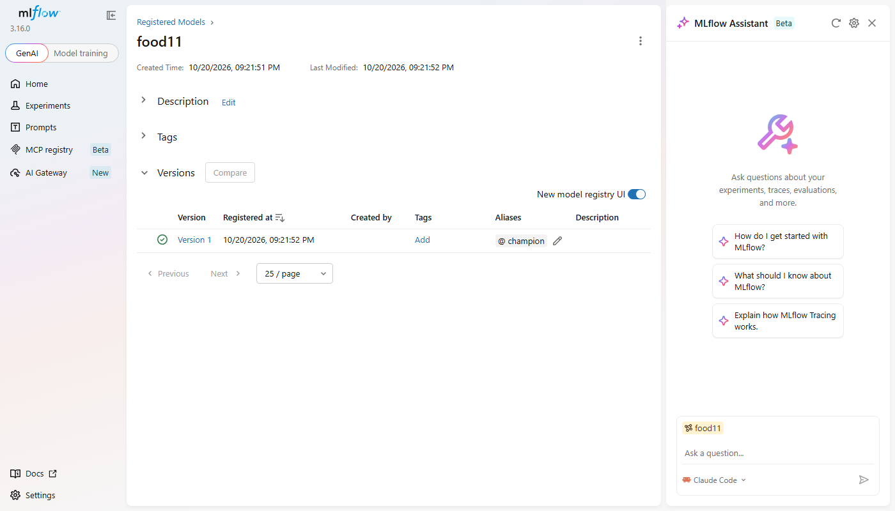
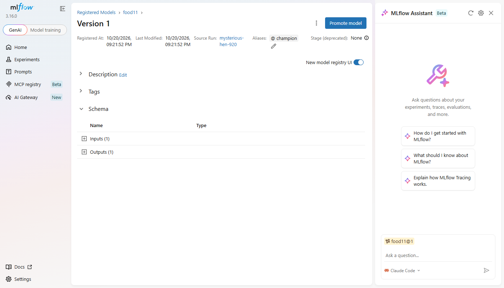

# Lab 3 - Containerizing the model with Docker

## What was done

| Step | Where |
|---|---|
| Best Lab 2 run registered as `food11` version 1, alias `champion` | MLflow Model Registry (run `cc8c24cb83d5496db3e15c4bb0091fa0`, `val_accuracy=0.791`) |
| Serving API (FastAPI): `GET /health`, `POST /predict` | [`src/food11/serve.py`](../src/food11/serve.py) |
| Serving dependencies (`fastapi uvicorn python-multipart`) | `pyproject.toml`, `uv.lock` |
| Multi-stage image (uv builder -> slim runtime) | [`Dockerfile`](../Dockerfile) |
| Build-context exclusions | [`.dockerignore`](../.dockerignore) |
| Image `food11-api:latest` built and run, `/predict` tested in the container | [`reports/lab3/container_predict.txt`](../reports/lab3/container_predict.txt) |
| Screenshots / command outputs for every question | [`reports/lab3/`](../reports/lab3) |

**What `serve.py` does:** at startup it reads `MLFLOW_TRACKING_URI` (default
`http://127.0.0.1:5000`) and loads `models:/food11@champion` once with
`mlflow.pyfunc.load_model`. For `/predict` it applies the same eval transform as training
(`Resize(256)`, `CenterCrop(224)`, ImageNet normalisation, reused from `train.py`). It runs
the model and returns the softmax top class and its probability, for example
`{"category": "Soup", "confidence": 0.9991}`. A file that is not an image gets a `400`.

### Setup changes needed to make the container work

1. **Proxied artifacts.** Lab 2's server was started with `--default-artifact-root ./mlruns`.
   As a result every artifact location in `mlflow.db` is a Windows path
   (`file:C:/Users/.../mlruns/1/...`), which a Linux container cannot open. The server is
   now started with `--artifacts-destination ./mlruns`, and the stored locations were
   rewritten to `mlflow-artifacts:/1/...`. Clients (host or container) now download model
   files **through the tracking server over HTTP** instead of reading the host's disk.
2. **Allowed hosts.** MLflow 3 rejects requests whose `Host` header isn't localhost or a
   private IP (DNS-rebinding protection). The container calls it as
   `host.docker.internal:5000`, so the server runs with
   `--allowed-hosts "localhost:*,127.0.0.1:*,host.docker.internal:*"`.
3. **CPU device.** The Lab 2 model was exported (`pt2`) on CPU. On a machine with a GPU,
   mlflow would try to load it on `cuda` and fail. `serve.py` passes
   `model_config={"device": "cpu"}`.
4. **CPU-only torch in the image.** `pyproject.toml` now picks the torch index per
   platform: `cu128` on Windows (local GPU training is unchanged) and `cpu` on Linux (the
   container). The CUDA wheels add several GB of `nvidia-*` libraries that a CPU container
   never uses. torch is pinned to `2.11.*` on both platforms, because that is the version
   that exported the model.

Tracking server used for this lab:

```bash
uv run mlflow server --host 127.0.0.1 --port 5000 --backend-store-uri sqlite:///mlflow.db --artifacts-destination ./mlruns --allowed-hosts "localhost:*,127.0.0.1:*,host.docker.internal:*"
```

### Build and run

```bash
docker build -t food11-api:latest .          # first build: 10 min 12 s (downloads ~1 GB of wheels), log in reports/lab3/build.log
docker run -p 8000:8000 -e MLFLOW_TRACKING_URI=http://host.docker.internal:5000 food11-api:latest
```

The results are the same locally (`uv run uvicorn ...`, see
[`local_predict.txt`](../reports/lab3/local_predict.txt)) and in the container (see
[`container_predict.txt`](../reports/lab3/container_predict.txt)):

```
$ curl http://127.0.0.1:8000/health
{"status":"ok"}
$ curl -X POST -F "file=@data/food11_processed_mini/validation/Bread/0_0.jpg" http://127.0.0.1:8000/predict
{"category":"Bread","confidence":0.2914}
$ curl -X POST -F "file=@data/food11_processed_mini/validation/Soup/9_0.jpg" http://127.0.0.1:8000/predict
{"category":"Soup","confidence":0.9991}
$ curl -X POST -F "file=@README.md" http://127.0.0.1:8000/predict
{"detail":"file is not an image"}
```

> At startup mlflow warns that the container's packages differ from the ones the model was
> logged with (`torch 2.11.0+cpu` vs `2.11.0+cu128`). This is expected: it is the same torch
> version, built for CPU instead of CUDA, and the predictions are identical.

---

### Registering the model (Option B, from code)

The best Lab 2 run (Question 9 of Lab 2) is `cc8c24cb83d5496db3e15c4bb0091fa0`, with
`lr=0.0001`, `batch_size=32` and `val_accuracy=0.791`.

```bash
uv run python -c "
import mlflow
mlflow.set_tracking_uri('http://127.0.0.1:5000')
v = mlflow.register_model('runs:/cc8c24cb83d5496db3e15c4bb0091fa0/model', 'food11')
mlflow.MlflowClient().set_registered_model_alias('food11', 'champion', v.version)
"
# Created version '1' of model 'food11'.
# food11 version 1 aliases ['champion'] run cc8c24cb83d5496db3e15c4bb0091fa0 source models:/m-d497a61db8264802801ae82eee056ed0
```

### Question 1 - Version number; logged model artifact vs registered model

The model was given **version 1**, because it is the first version registered under the
name `food11`.



- A **logged model artifact** is the set of files a run saved: weights, `MLmodel`,
  `conda.yaml`/`requirements.txt`, signature and input example. They are stored under that
  run (`mlruns/1/models/m-.../artifacts`) and identified only by run and model ID. Every
  run has one, good or bad.
- A **registered model** is a named entry in the Model Registry (`food11`) whose numbered
  **versions** each point to one of those logged artifacts. It adds what a deployment
  needs: a stable name, increasing version numbers, aliases, tags, descriptions, and a link
  back to the run that produced it. Registering a model doesn't retrain or change it. It
  promotes one specific artifact into a curated, addressable catalogue.

### Question 2 - Aliases instead of stages; why separate versioning; why aliases are more flexible

The fixed stages `None` / `Staging` / `Production` / `Archived` were replaced by
**aliases**: free-form, mutable pointers such as `champion` and `challenger`. Free-form
**tags** cover any other metadata.

- **Why version separately from runs:** a run is an *experiment record*. There are many of
  them, most never deployed, and they are named by random IDs. The registry keeps only the
  models worth deploying, with a stable name and a linear history (v1, v2, ...). Consumers
  (the API, CI, other teams) can depend on `food11` without knowing anything about
  experiments. Lineage is kept, because each version still links to its run, params and
  metrics.
- **Why aliases are more flexible:** stages were a fixed set of four names with built-in
  meaning, allowing one "Production" slot per model. Aliases can have any name and you can
  define as many as you need, for example `champion`, `challenger`, `shadow` or
  `canary-eu`. Each alias points to exactly one version and can be moved in one call.
  Promoting or rolling back means moving the pointer: the version numbers never change,
  and the serving code keeps loading `models:/food11@champion`.

The version page shows the alias next to the deprecated stage field (`Stage (deprecated):
None`). It also links back to the source run `mysterious-hen-920` (`cc8c24cb...`):



### Question 3 - Why load `models:/food11@champion` instead of the `.pth` file; serving a newer version

- A `.pth` path ties the server to one file on one disk. It also needs the model class code
  to rebuild the network, and it carries no information about which run or data produced
  it. The model URI is **resolved by the tracking server**: the same code works on a laptop
  or in a container, as long as the server is reachable. The pyfunc wrapper also brings the
  flavor, the signature and the dependency list, so serving doesn't need to know the
  framework details.
- **To serve a newer version:** register it (v2), move the `champion` alias to v2, and
  **restart** the API, since the model is loaded once at startup. No code change and no
  image rebuild are needed.

### Question 4 - Why copy `pyproject.toml`/`uv.lock` and `uv sync` before the source

Docker caches each instruction as a layer and reuses it as long as that instruction and
everything before it are unchanged. Installing dependencies (torch, mlflow, ...) is by far
the slowest and largest step, and it depends only on `pyproject.toml` and `uv.lock`, which
rarely change. Copying those two files first means the `uv sync` layer stays cached
across code edits.

If you change one line in `serve.py`, only `COPY src/ ./src/` and the layers after it are
rebuilt. The builder stage and the venv copy come from the cache, so the rebuild takes
seconds instead of many minutes. Copying everything at once (`COPY . .` before `uv sync`)
would invalidate the dependency layer on every code change. It would also reinstall
everything.

`--no-install-project` is needed because `src/` isn't in the builder yet: only the
dependencies are installed there, and the code is added in the runtime stage.

**Measured** ([`q4_rebuild_cache.txt`](../reports/lab3/q4_rebuild_cache.txt)): after
changing one line in `serve.py` (the FastAPI title), the rebuild took **4 s** instead of
**10 min 12 s**. Every layer up to `uv sync` and the venv copy is `CACHED`, and only
`COPY src/ ./src/` ran again:

```
#12 [builder 5/5] RUN uv sync --frozen --no-dev --no-install-project
#12 CACHED
#15 [stage-1 3/4] COPY --from=builder /app/.venv /app/.venv
#15 CACHED
#16 [stage-1 4/4] COPY src/ ./src/
#16 DONE 0.0s
total build time: 4s
```

### Question 5 - Single-stage vs multi-stage size, biggest layers

The naive image ([`reports/lab3/Dockerfile.naive`](../reports/lab3/Dockerfile.naive)) runs
the same steps in a single `python:3.12` stage and starts the app from there. Full output is
in [`q5_sizes_history.txt`](../reports/lab3/q5_sizes_history.txt).

| Image | Size on disk | Compressed (content) |
|---|---|---|
| naive single-stage (`food11-api:naive`) | **6.05 GB** | 1.37 GB |
| multi-stage (`food11-api:latest`) | **2.57 GB** | 563 MB |

The multi-stage image is **2.4x smaller**, saving 3.5 GB. `docker history` shows where the
difference comes from:

| Layer | naive | multi-stage |
|---|---|---|
| Base image | `python:3.12`, about **1.1 GB** (gcc, headers and dev libraries: `apt-get` layers of 695 MB + 202 MB + 65 MB, plus 134 MB Debian) | `python:3.12-slim`, about **134 MB** |
| uv binary | 57.5 MB | not copied |
| Dependencies | `RUN uv sync`: **3.43 GB**, i.e. the 1.8 GB venv **plus 1.5 GB of uv's download cache** (`/root/.cache/uv`) left in the layer | `COPY /app/.venv`: **1.87 GB**, only the venv |
| App code | 57 kB | 57 kB |

So the biggest layer in both images is the virtualenv, mostly `torch` plus `mlflow`,
`pandas`, `scipy` and `dvc`. The multi-stage build removes everything that is only needed
to *build* it: the compiler toolchain of the full base image, uv itself and uv's cache.

The image is this small only because it uses **CPU-only torch** (change 4 above). With
the `cu128` wheels from Lab 2, the venv alone would be several GB larger, because of the
`nvidia-*` CUDA libraries.

### Question 6 - Forgetting `.dockerignore`

Without it, `docker build` sends the **whole folder** as build context to the daemon before
it runs a single instruction. Measured sizes
([`context_sizes.txt`](../reports/lab3/context_sizes.txt)):

| Excluded | Size |
|---|---|
| `.venv/` (Windows virtualenv with CUDA torch) | 4.9 GB |
| `data/` (Food-11 raw + processed, DVC-tracked) | 1.4 GB |
| `.dvc/` (DVC cache: a second copy of the data) | 1.4 GB |
| `processed/` | 1.3 GB |
| `mlruns/` (artifacts of every Lab 2 run) | 205 MB |
| `models/`, `.git/`, `reports/`, `mlflow.db`, ... | about 10 MB |
| **What the build actually uses:** `src/` (93 kB), `pyproject.toml`, `uv.lock` (672 kB) | **< 1 MB** |

So the context would be about **9 GB instead of under 1 MB**, sent again on *every*
build. The build becomes much slower even when every layer is cached.
Any `COPY .` would put that content into the image and inflate it, and any change in those
folders would invalidate the cache.

The excluded folders that would actually **break** the build or the image:
- **`.venv/`**: with any broad `COPY`, the host's **Windows** venv (`Scripts/*.exe`,
  Windows wheels) would land on top of the Linux venv built by `uv sync`, and the
  container could no longer import torch or start uvicorn.
- **`mlflow.db`**: while the tracking server is running, Windows keeps the file locked, so
  sending the context can fail with a read error.
- `data/` is too large for the context to finish in reasonable time, or for the disk Docker
  Desktop uses.

### Question 7 - Why not `127.0.0.1:5000` from inside the container; what `host.docker.internal` is

A container has its **own network namespace**, so its `127.0.0.1` is the container's own
loopback interface. Nothing listens on port 5000 there: the mlflow server listens on the
**host's** loopback. `host.docker.internal` is a DNS name that Docker Desktop injects into
containers. It resolves to an internal IP of the host as seen from the Docker VM, and
traffic to it is forwarded to the Windows host. Here:

```
$ docker run --rm python:3.12-slim getent hosts host.docker.internal
192.168.65.254  host.docker.internal
```

On Linux `--network host` removes the network isolation instead, so `127.0.0.1` is the
host's address.

### Question 8 - New container from the same image: does the model still load?

**Yes.** The new container `food11-api-2` was started from the same image with no rebuild.
It loaded the model and answered `/predict` with the same result
([`q8_new_container.txt`](../reports/lab3/q8_new_container.txt)):

```
$ docker stop food11-api && docker rm food11-api
$ docker run -d --name food11-api-2 -p 8000:8000 -e MLFLOW_TRACKING_URI=http://host.docker.internal:5000 food11-api:latest
$ docker logs food11-api-2
INFO:     Waiting for application startup.
Downloading artifacts: 100%|##########| 8/8 [00:02<00:00,  3.03it/s]
INFO:     Application startup complete.
$ curl -X POST -F "file=@data/food11_processed_mini/validation/Soup/9_0.jpg" http://127.0.0.1:8000/predict
{"category":"Soup","confidence":0.9991}
```

The tracking server's log shows the new container downloading the model files through it
(`GET /api/2.0/mlflow-artifacts/artifacts/1/models/m-d497a61d.../artifacts/data/model.pt2`,
and so on). Starting the same image with **no** reachable server makes the API fail at startup:

```
mlflow.exceptions.MlflowException: API request to http://host.docker.internal:5999/api/2.0/mlflow/registered-models/alias failed ... Connection refused
ERROR:    Application startup failed. Exiting.
```

This shows what is baked in and what isn't. The image contains only the **code and
dependencies**. The model is **not** inside it:
every new container calls the tracking server at startup, resolves `food11@champion` to a
version, and downloads that version's artifacts. Two consequences:
- moving the alias and restarting a container makes it serve a different model without a
  rebuild, and
- the container depends on the tracking server being reachable at startup. If the server
  is down, the API cannot start.

### Question 9 - What's missing before another machine can pull and run this exact image?

- **An image registry.** The image exists only in the local Docker Desktop. It needs to be
  pushed to Docker Hub, GHCR or a cloud registry, with an **immutable tag** (git commit
  SHA or version) or referenced by **digest** instead of `latest`.
- **Automated, reproducible builds:** a CI job that builds from a given commit and pushes
  the image, so the git version and the image tag stay linked.
- **A reachable model source.** `host.docker.internal:5000` and a SQLite and local-disk
  MLflow work only on this laptop. The other machine needs a shared tracking server, with
  artifacts on shared storage such as S3 or GCS and credentials passed in as secrets or
  environment variables.
- Optionally, a CPU-only build (or a GPU node with CUDA drivers), resource limits and a
  health check (`/health`) for the orchestrator.
