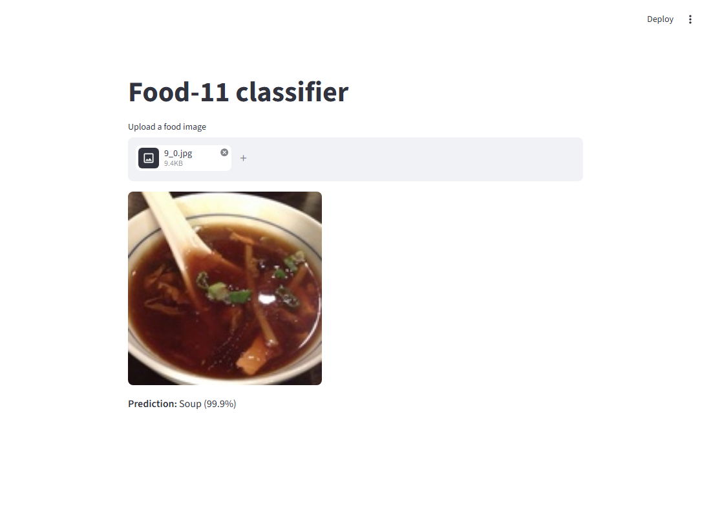
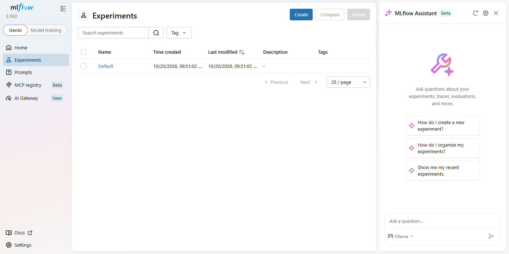
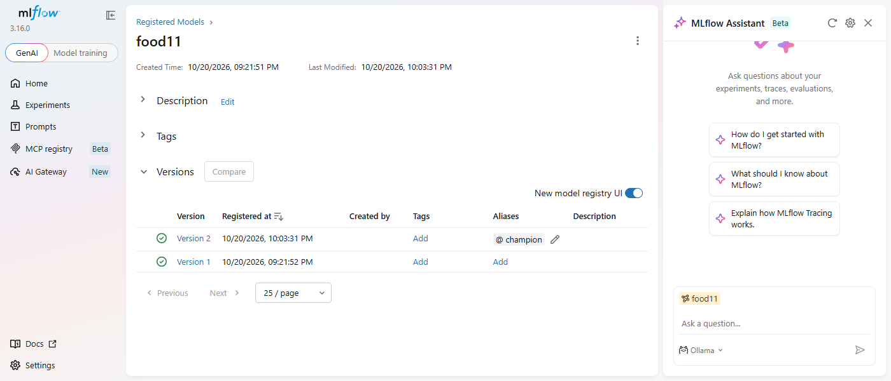
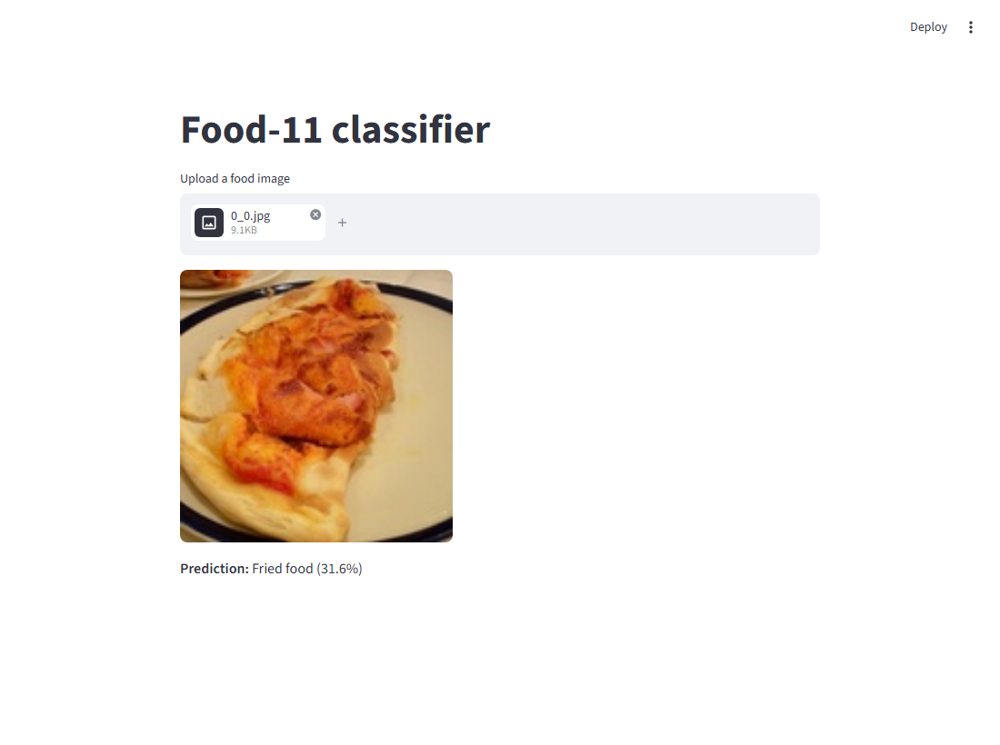

# Lab 4 - Orchestrating the app with Docker Compose

## What was done

| Step | Where |
|---|---|
| mlflow tracking server + registry image | [`mlflow/Dockerfile`](../mlflow/Dockerfile) |
| Streamlit upload page + its image | [`frontend/app.py`](../frontend/app.py), [`frontend/Dockerfile`](../frontend/Dockerfile) |
| The three services, network and named volume | [`docker-compose.yml`](../docker-compose.yml) |
| Inference service | Lab 3 [`Dockerfile`](../Dockerfile) + [`src/food11/serve.py`](../src/food11/serve.py), **unchanged** (only `MLFLOW_TRACKING_URI` differs) |
| Command outputs and screenshots for every question | [`reports/lab4/`](../reports/lab4) |

```
            host (published ports only)
   :5000 |                         | :8501
 +-------v------+   +-----------+  +-v--------+
 |   mlflow     |<--| inference |<-| frontend |   compose network "mlops-lab-1_default"
 | server+UI    |   | FastAPI   |  | Streamlit|   (service names resolve via Compose DNS)
 +------+-------+   +-----------+  +----------+
        |  http://mlflow:5000   http://inference:8000
 [volume mlflow-data] -> /mlflow-data/{mlflow.db, mlruns/}
```



### Changes compared with the lab sheet, and why

1. **`mlflow/Dockerfile` CMD** (otherwise the stack can't work):
   - `--artifacts-destination /mlflow-data/mlruns` instead of `--default-artifact-root`.
     With `--default-artifact-root`, every model's location is stored as a *path inside the
     mlflow container* (`/mlflow-data/mlruns/...`). The inference container doesn't mount
     that volume, so it can't read those files. With `--artifacts-destination`, locations
     are stored as `mlflow-artifacts:/...` and clients download the files **through the
     mlflow server over HTTP** (same fix as Lab 3).
   - `--allowed-hosts "mlflow:5000,localhost:*,127.0.0.1:*"`. mlflow 3 rejects any `Host`
     header that isn't localhost or a private IP (DNS-rebinding protection). Inside
     Compose, inference calls it as `mlflow:5000`. Without this flag it gets
     ([`allowed_hosts_403.txt`](../reports/lab4/allowed_hosts_403.txt)):
     ```
     $ curl -H "Host: mlflow:5000" "http://127.0.0.1:5000/api/2.0/mlflow/registered-models/alias?name=food11&alias=champion"
     Invalid Host header - possible DNS rebinding attack detected
     HTTP 403
     ```
   - `mlflow==3.16.0` is pinned: the same version that created `mlflow.db` in Labs 2-3,
     and the same client as the inference image.
2. **Staging -> alias `champion`.** The lab sheet still says "move it to `Staging`", but Lab 3
   moved to **aliases** because stages are deprecated, and `serve.py` loads
   `models:/food11@champion`. "Move to Staging" is therefore done here as "move the
   `champion` alias". The mechanism is the same: a mutable pointer that inference resolves
   at startup.
3. **Seeding the volume.** A new named volume starts empty: no runs, no `food11` model.
   To keep the Lab 2 runs and the Lab 3 registry, they were copied into the volume
   **once**, before the first `up` ([`seed_volume.txt`](../reports/lab4/seed_volume.txt)):
   ```bash
   docker compose create      # creates network, volume, containers; starts nothing
   docker run --rm -v mlops-lab-1_mlflow-data:/mlflow-data -v "${PWD}:/host:ro" python:3.11-slim \
     sh -c "cp /host/mlflow.db /mlflow-data/ && mkdir -p /mlflow-data/mlruns && cp -r /host/mlruns/1 /mlflow-data/mlruns/"
   ```
   This works because Lab 3 already rewrote the stored artifact locations to
   `mlflow-artifacts:/1/...`, which the server maps to `/mlflow-data/mlruns/1/...`.
4. **Readiness** (Question 6): a healthcheck on `mlflow`, `condition: service_healthy` and
   `restart: on-failure` on `inference`.

---

### Question 1 - `/mlflow-data` without a volume

Everything written there goes into the **container's writable layer**. It survives a
`stop`/`start` of *that* container, but it is deleted together with the container on
`docker rm`. A new container from the same image starts from the image's filesystem, so
it gets an **empty** `/mlflow-data` and creates a fresh `mlflow.db`.

Tried it ([`q1_no_volume.txt`](../reports/lab4/q1_no_volume.txt)):

```
$ docker run -d --name mlflow-standalone -p 5050:5000 mlops-lab-1-mlflow   # no volume
$ (create an experiment "q1-test" through the API)
experiments: ['q1-test', 'Default']
$ docker stop mlflow-standalone && docker rm mlflow-standalone
$ docker run -d --name mlflow-standalone-2 -p 5050:5000 mlops-lab-1-mlflow
experiments: ['Default']
$ docker inspect -f "{{json .Mounts}}" mlflow-standalone-2
[]
```

The UI of the new container shows only the `Default` experiment. Everything from the first
container is gone:



### Question 2 - Named volume vs bind mount

A **named volume** is created and managed by Docker, so it doesn't depend on any host
path. `docker compose up` creates it on any machine, and the same compose file works on
Windows, Mac and Linux. Docker stores it inside its own VM/filesystem, which is much faster
than a bind mount from Windows into the Linux VM, and it uses the container's Linux
permissions. It is the database's storage, not a folder anyone edits by hand. It also has
a lifecycle tied to the project: `docker compose down -v` removes it on purpose
(Question 10).

A **bind mount** (for example `./mlflow-data:/mlflow-data`) **would also work** functionally,
and the data would survive in the same way. But it ties the setup to a host folder that
must exist with the right permissions. On Windows that means SQLite running through the
slow, lock-unfriendly Windows-to-Linux file-sharing layer. It also puts `mlflow.db` and GBs
of artifacts inside the git working tree, where they need `.gitignore` and
`.dockerignore` rules. A bind mount is better for **source code** you edit live during
development, and a named volume is better for **state owned by a service**.

### Question 3 - Why `http://mlflow:5000` resolves now

Compose puts all services on a user-defined bridge network (`mlops-lab-1_default`), and
Docker runs an **embedded DNS server** (127.0.0.11) for such networks. It resolves every
**service name** to the IP of that service's container. In Lab 3 the container ran alone on
the default bridge network, which has no service DNS, and mlflow ran on the *host*, not in
a container. The only way out was `host.docker.internal` or `--network host`. Measured from
inside the frontend container
([`q5_q7_ports_dns.txt`](../reports/lab4/q5_q7_ports_dns.txt)):

```
mlflow -> 172.18.0.2
inference -> 172.18.0.3
frontend -> 172.18.0.4
```

### Question 4 - `INFERENCE_URL` from the environment

So that **the same image works anywhere** and only configuration changes. `inference` is a
name that exists only inside this compose network. If the frontend image is run on its own
(`docker run -p 8501:8501 mlops-lab-1-frontend`), the hardcoded `http://inference:8000`
would fail DNS resolution on every upload, and the only fix would be a rebuild. With the
environment variable it can point to `http://host.docker.internal:8000`, a staging URL, a
Kubernetes service name or a load balancer, without rebuilding. The default
`http://127.0.0.1:8000` also makes `streamlit run app.py` work directly on a laptop next to
`uv run uvicorn ...`. This follows the 12-factor rule of keeping configuration in the
environment and the code and image environment-agnostic. It is exactly how `serve.py`
handles `MLFLOW_TRACKING_URI`.

### Question 5 - Why `inference` publishes no port

Only humans need to reach a service **from the host**: the frontend page (8501) and the
mlflow UI (5000). `inference` is only called by `frontend`, and that traffic stays inside
the compose network. There the frontend reaches `inference:8000` directly on the
container's own port, through Compose DNS. Published ports are for traffic that comes
**from outside** Docker. Not publishing it keeps the API private: nobody on the host or the
LAN can bypass the frontend, and it avoids port conflicts on the host.

```
$ curl http://127.0.0.1:8000/health                                  # from the host
  -> connection failed (port 8000 is not published)
$ docker compose exec frontend python -c "import requests; print(requests.get('http://inference:8000/health').text)"
{"status":"ok"}                                                      # from inside the network
```

### Question 6 - `depends_on` and a mlflow that isn't ready

With the lab's plain `depends_on: [mlflow]`, the first `docker compose up` **happened** to
work. Importing torch in the inference container takes longer than mlflow needs to start,
so the model load arrived after the server was ready. That is luck, not a guarantee. The
race was forced by making mlflow unavailable while inference starts
([`q6_depends_on_failure.txt`](../reports/lab4/q6_depends_on_failure.txt)):

1. **mlflow back within a few seconds.** `serve.py` stays at `Waiting for application
   startup`, because the mlflow client **retries** failed HTTP calls (7 retries with
   exponential backoff by default). The pending request succeeds and startup completes.
2. **mlflow away longer than that retry window.** After **284 s** the lifespan raises, and
   uvicorn exits with **code 3**:
   ```
   mlflow.exceptions.MlflowException: API request to http://mlflow:5000/api/2.0/mlflow/registered-models/alias failed with exception HTTPConnectionPool(host='mlflow', port=5000): Max retries exceeded ...
   ERROR:    Application startup failed. Exiting.
   ```
   The container **stays dead**, even after mlflow is back:
   ```
   SERVICE     STATUS
   frontend    Up 10 minutes
   inference   Exited (3) 24 seconds ago
   mlflow      Up 20 seconds
   ```
   The frontend keeps running, but every upload fails, because `inference` no longer
   resolves to a running container.

`depends_on` only orders **container starts**. It knows nothing about whether the
*application* inside is ready, and it doesn't restart anything. The fix is in
`docker-compose.yml` ([`q6_healthcheck_fix.txt`](../reports/lab4/q6_healthcheck_fix.txt)):

```yaml
  mlflow:
    healthcheck:            # "healthy" = GET /health answers
      test: ["CMD", "python", "-c", "import urllib.request; urllib.request.urlopen('http://localhost:5000/health', timeout=3)"]
      interval: 5s
      retries: 12
      start_period: 10s
  inference:
    depends_on:
      mlflow:
        condition: service_healthy   # wait for readiness, not just the process
    restart: on-failure              # a crashed model load is retried
```

```
$ docker compose up -d
Container mlops-lab-1-mlflow-1 Started
Container mlops-lab-1-mlflow-1 Waiting
Container mlops-lab-1-mlflow-1 Healthy
Container mlops-lab-1-inference-1 Started      <- only after mlflow is healthy
$ docker compose ps
inference   Up Less than a second
mlflow      Up 6 seconds (healthy)
```

`restart: on-failure` handles mlflow disappearing **later**. Its effect is visible in
Question 10, where inference shows `Restarting (3)` instead of staying `Exited`.

### Question 7 - `docker compose ps`

```
$ docker compose ps
NAME                      SERVICE     STATUS              PORTS
mlops-lab-1-frontend-1    frontend    Up About a minute   0.0.0.0:8501->8501/tcp, [::]:8501->8501/tcp
mlops-lab-1-inference-1   inference   Up About a minute   8000/tcp
mlops-lab-1-mlflow-1      mlflow      Up About a minute   0.0.0.0:5000->5000/tcp, [::]:5000->5000/tcp
```

`mlflow` and `frontend` show a **published** mapping (`0.0.0.0:5000->5000`,
`0.0.0.0:8501->8501`). `inference` only shows `8000/tcp`: the port the image `EXPOSE`s,
reachable only inside the network. This matches `docker-compose.yml`, where only `mlflow`
and `frontend` have a `ports:` section. From the host, 5000 and 8501 answer `HTTP 200` and
8000 refuses the connection.

### Question 8 - New version: which model answers?

Version 2 was registered from another Lab 2 run (`ed6a7111...`, `lr=0.001`,
`batch_size=64`), and **`champion` was moved from v1 to v2**. The same image
(`Bread/0_0.jpg`) was uploaded three times
([`q8_q9_new_version.txt`](../reports/lab4/q8_q9_new_version.txt)):

| Moment | Frontend shows | Served model |
|---|---|---|
| before the change (`champion` -> v1) | **Bread (29.1%)** | v1 |
| `champion` moved to v2, inference **not** restarted | **Bread (29.1%)** | still **v1** |
| after `docker compose restart inference` | **Fried food (31.6%)** | **v2** |

After the alias move, the prediction still comes from the **old** model. `serve.py`
resolved `models:/food11@champion` and loaded the weights **once, at startup**, and the
running process keeps them in memory. The single command that picks up the new version is:

```bash
docker compose restart inference
```



| Before (v1) | Alias moved, not restarted (still v1) | After restart (v2) |
|---|---|---|
|  |  |  |

### Question 9 - Why `restart` is enough

The inference image contains only **code and dependencies**: `serve.py`, the venv with
torch, mlflow and FastAPI. It doesn't contain the model and doesn't know a version number.
At every container start, the lifespan asks the tracking server "which version is
`food11@champion`?" and **downloads that version's artifacts** at runtime:

```
$ docker compose logs inference
Downloading artifacts: 100%|##########| 7/7 [00:00<00:00, 36.83it/s]
Application startup complete.
```

A restart re-runs that lookup, so it picks up whatever the alias points to **now**. A
rebuild would only be needed if the *code* or the *dependencies* changed. **Model
promotion is a registry operation, not a deployment of a new image**, and the image stays
the same through any number of model versions. The trade-off is that the running process
doesn't notice alias changes by itself. You need a restart, or code that polls the
registry or exposes a `/reload` endpoint.

### Question 10 - `down`/`up` vs `down -v`

([`q10_persistence.txt`](../reports/lab4/q10_persistence.txt))

**`docker compose down` + `up`: everything is still there.** `down` removes the containers
and the network, but **not** named volumes:

```
$ docker compose down
Container mlops-lab-1-frontend-1 Removed
Container mlops-lab-1-inference-1 Removed
Container mlops-lab-1-mlflow-1 Removed
Network mlops-lab-1_default Removed
$ docker volume ls
local     mlops-lab-1_mlflow-data
$ docker compose up -d
food11@champion -> version 2
```

**`docker compose down -v` + `up`: the registry is gone.** `-v` also removes the named
volumes declared in the compose file. `up` then creates a **new, empty** `mlflow-data`, and
mlflow starts with a fresh `mlflow.db`: no runs, no `food11`, no alias. Inference can't
load its model and crash-loops, because `restart: on-failure` keeps retrying a model that
doesn't exist:

```
$ docker compose down -v
Volume mlops-lab-1_mlflow-data Removed
$ docker compose up -d
Volume mlops-lab-1_mlflow-data Created
food11@champion -> RESOURCE_DOES_NOT_EXIST: Registered Model with name=food11 not found
$ docker compose ps -a
inference   Restarting (3) 1 second ago
mlflow      Up 46 seconds (healthy)
```

The named volume is the **only** place this state lives, so its lifecycle is independent of
the containers. `down -v` is the "factory reset", and it is irreversible without a backup.
After the test the volume was seeded again with the same `docker run ... cp` command shown
above, and the stack is back to `champion -> version 1`.

### Question 11 - What Compose can't give you

Compose runs services on **one Docker host**, with no scheduler and no control plane. It's
missing:

- **Multi-node scheduling and failover.** If the machine dies, every service dies with it.
  Nothing reschedules containers on another node. That needs an orchestrator (Kubernetes,
  or the older Docker Swarm) with several nodes.
- **Replicas behind a real load balancer.** `docker compose up --scale inference=3` starts
  3 containers on the same machine, and Docker DNS round-robins the name. But there is no
  readiness-aware load balancing, no rolling updates (zero-downtime deploys), no
  autoscaling and no self-healing beyond `restart:`. Kubernetes gives a `Deployment` with
  `replicas: 3`, a `Service` that balances only over *ready* pods (readiness probes), and an
  `HorizontalPodAutoscaler`.
- **Storage that outlives the machine.** The `mlflow-data` volume is a directory on this
  host's disk. For mlflow to survive a machine failure, its state must leave the node: a
  managed database instead of SQLite (PostgreSQL/MySQL with replication and backups),
  artifacts in object storage (S3/GCS/MinIO), and several stateless mlflow server replicas
  behind a load balancer. SQLite in a local volume can't be shared by several replicas or
  nodes.
- **Images that other nodes can pull:** a container registry (Question 9 of Lab 3), plus
  secrets management and resource limits/quotas per service.
